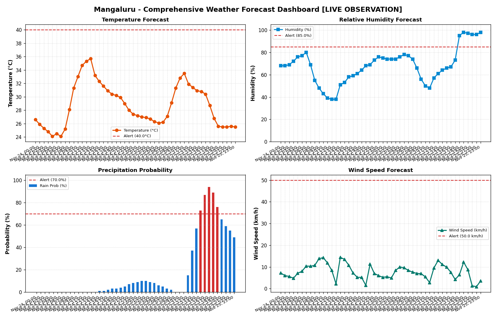
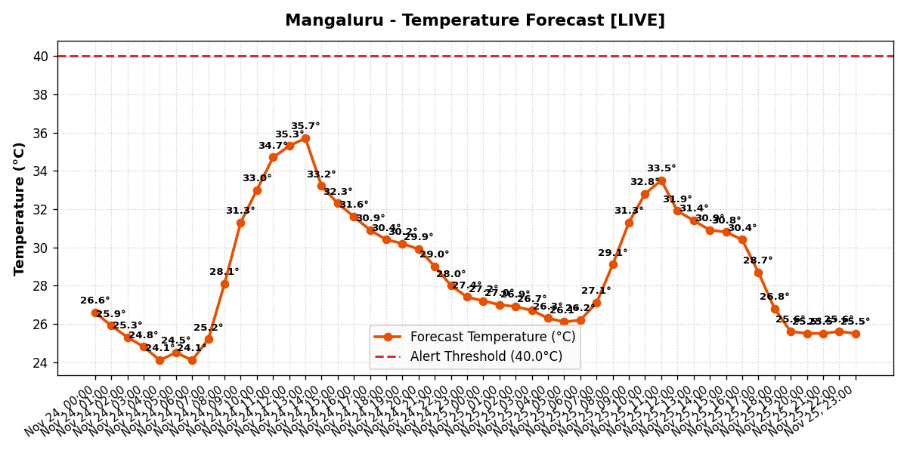
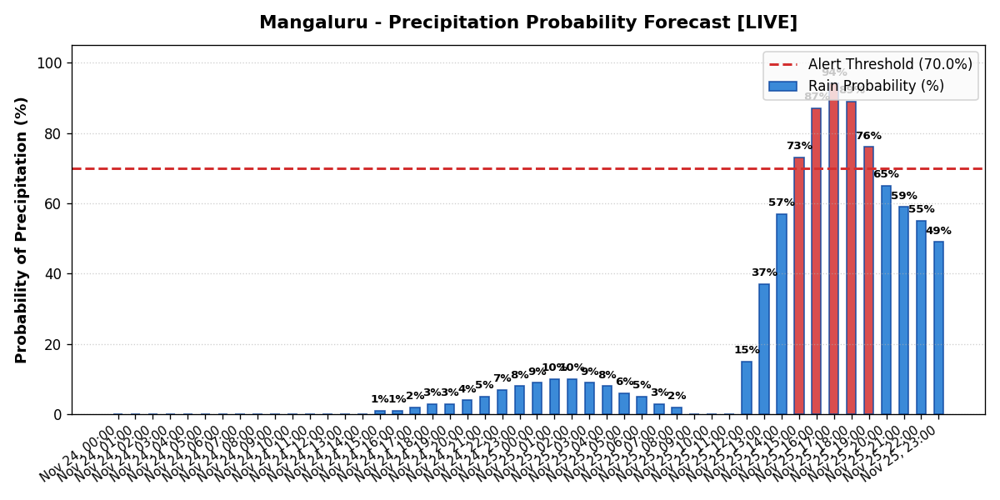
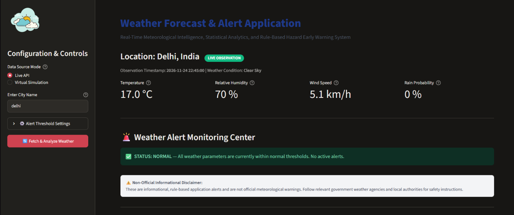
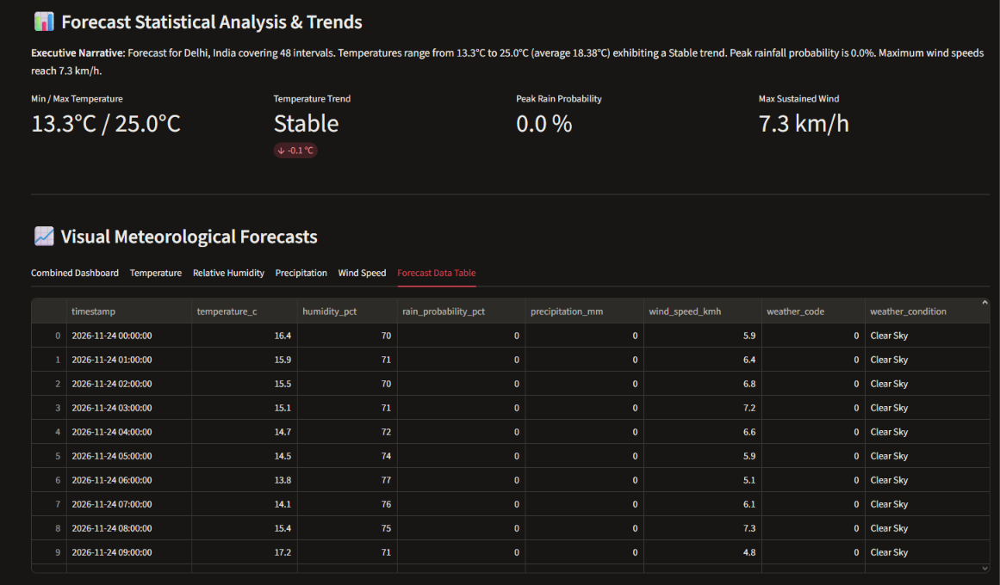
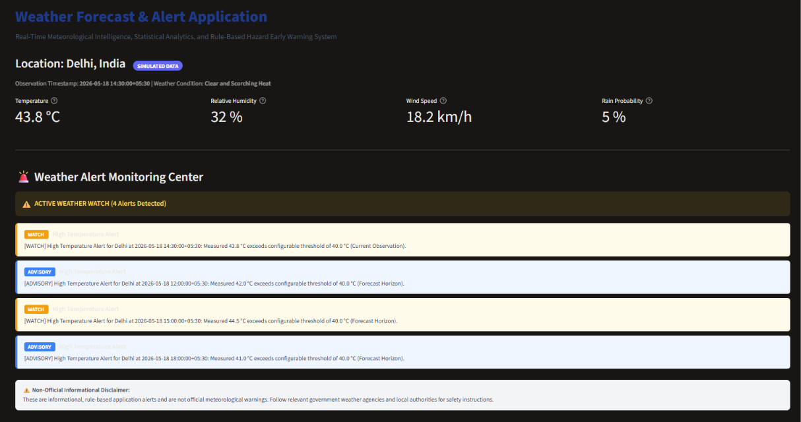
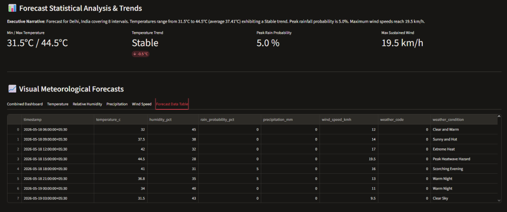

# ⛅ Weather Forecast & Alert Application

[](https://www.python.org/)
[](https://opensource.org/licenses/MIT)
[](https://streamlit.io/)
[](https://pandas.pydata.org/)
[](https://pytest.org/)

An industry-standard, modular Python application designed for **real-time meteorological tracking**, **predictive trend analysis**, **rule-based weather hazard alerting**, and **interactive visual dashboarding**.

Supports both **Live Worldwide Open-Meteo REST API Data** and **Zero-Dependency Offline Virtual Simulation** across 6 distinct meteorological scenarios.

---

> ### ⚠️ Mandatory Safety Notice
> **Informational Non-Official Alerts**: All application-generated alert notifications, severity tiers (Advisory, Watch, Warning), and compound risk badges are rule-based software calculations designed for testing, educational demonstrations, and situational awareness. **They do not constitute official meteorological warnings.** Always refer to certified government meteorological agencies and local emergency authorities for safety directives.

---

## 📸 Visual Previews

### 1. Combined Weather Dashboard


### 2. Temperature Forecast with Alert Threshold Overlay


### 3. Precipitation Probability Forecast


---

## 🎯 Project Overview & Practical Use Cases

### The Problem
Accessing raw weather API responses often leaves users and applications overwhelmed by nested JSON structures, inconsistent missing values, and lack of actionable hazard alerts. Furthermore, developers frequently cannot test extreme meteorological edge cases (such as severe heatwaves or cyclonic storms) using live weather APIs during normal calm weather.

### The Solution
This application provides an end-to-end meteorological pipeline that:
1. **Normalizes Heterogeneous Data**: Transforms live JSON API payloads into structured, strongly-typed Pandas DataFrames.
2. **Preserves Missing Values**: Treats missing sensors as `None` / `NaN` rather than skewing calculations with artificial zeros.
3. **Dual Data Sourcing (Live & Simulation)**: Features 6 offline simulation fixtures so evaluators can test extreme boundary conditions without network access or API quotas.
4. **Autonomous Rule Engine**: Evaluates current and forecast conditions against configurable thresholds, classifying severity into **Advisory**, **Watch**, and **Warning**.
5. **Dual Presentation Layer**: Offers both a clean terminal CLI (`main.py`) and a modern interactive web dashboard (`app.py`).

---

## ✨ Feature Highlights

- **Worldwide Geocoding**: Automatically converts human city names (e.g., `"Mangaluru"`, `"Tokyo"`, `"London"`) into exact geographic coordinates.
- **Open-Meteo REST API Integration**: Queries current weather observations and multi-day hourly forecast intervals with zero API key requirement.
- **6 Calibrated Offline Simulation Scenarios**: Test normal weather, heatwaves, monsoon downpours, coastal gales, high humidity, and compound risks offline.
- **Statistical Analytics Engine**: Calculates Min, Max, Average, Cumulative Precipitation, Peak Gusts, and Macro Temperature Trends (`Warming`, `Cooling`, `Stable`).
- **Compound Multi-Hazard Early Warnings**: Automatically identifies when 2 or more distinct hazards breach thresholds simultaneously.
- **Publication-Ready Matplotlib Visualizations**: Generates 5 dedicated charts saved in `outputs/` with headless memory leak prevention.
- **Persistent Observation Logging**: Appends current observations to `reports/weather_reports.csv` without overwriting historical records.
- **Atomic JSON Audit Reports**: Exports standalone JSON reports in `reports/` with temporary-swap safety against interrupted writes.
- **Comprehensive Test Suite**: **89 automated tests** verifying networking, data processing, trends, alerts, charts, and file I/O with 100% offline mocked reliability.

---

## 🛠️ Technology Stack

| Technology | Purpose in Project |
|---|---|
| **Python 3.10+** | Core programming language |
| **Requests (>=2.31)** | HTTP communication with Open-Meteo REST APIs |
| **Pandas (>=2.0)** | Time-series normalization, tabular transformations, and statistical summaries |
| **NumPy (>=1.24)** | High-performance numerical operations and missing-value (`NaN`) management |
| **Matplotlib (>=3.7)** | Headless (`Agg` backend) rendering of time-series plots and multi-panel dashboards |
| **Streamlit (>=1.28)** | Browser-based interactive dashboard with KPI cards and export downloads |
| **python-dotenv (>=1.0)** | Secure loading of environment variables from `.env` |
| **Pytest (>=7.4)** | Automated test framework with `unittest.mock` fixtures |

---

## 🏛️ System Architecture

The application strictly obeys the **Separation of Concerns (SoC)** and **Orchestration Service Pattern**:

```
                       USER INTERACTION
              +---------------+---------------+
              |                               |
              v                               v
     Terminal CLI (main.py)          Streamlit App (app.py)
              |                               |
              +---------------+---------------+
                              |
                              v
                  src/weather_service.py
               (execute_weather_workflow)
                              |
      +-----------------------+-----------------------+
      |                                               |
      v                                               v
[Mode: LIVE API]                             [Mode: SIMULATION]
src/weather_api.py (Requests)            data/sample_weather.json
Open-Meteo REST API                      Offline Synthetic Fixtures
      |                                               |
      +-----------------------+-----------------------+
                              |
                              v
                   src/data_processing.py
             (JSON Parsing, Range Validation,
              Pandas DataFrame Normalization)
                              |
      +-----------------------+-----------------------+
      |                                               |
      v                                               v
src/forecast_analysis.py                    src/alert_system.py
(Min, Max, Avg, Trends,                     (Configurable Thresholds,
 Peak Intervals)                             Compound Risk Detection)
      |                                               |
      +-----------------------+-----------------------+
                              |
      +-----------------------+-----------------------+
      |                                               |
      v                                               v
src/visualization.py                       src/report_generator.py
(Matplotlib Headless Plots,                 (Persistent CSV Append,
 4-Panel Dashboard PNG)                      Atomic JSON Export)
      |                                               |
      +-----------------------+-----------------------+
                              |
                              v
                    PRESENTATION LAYER
           (Rendered in Terminal or Streamlit Web)
```

---

## 📂 Repository File Structure

```text
Weather-Forecast-Alert-Application/
│
├── app.py                      # Interactive Streamlit Web Dashboard
├── main.py                     # Interactive Command-Line Interface (CLI)
│
├── config/                     # Configuration management package
│   └── settings.py
│
├── data/                       # Offline virtual simulation fixtures
│   ├── .gitkeep
│   ├── sample_weather.json     # Current weather snapshots across 6 scenarios
│   └── sample_forecast.json    # 24-hour forecast time-series across 6 scenarios
│
├── docs/                       # Technical project documentation
│   ├── architecture.md         # Detailed modular design and data flow
│   └── installation.md         # Complete installation and virtual environment guide
│
├── images/                     # Screenshot assets and chart previews for README
│   ├── .gitkeep
│   ├── precipitation_forecast_preview.png
│   ├── temperature_forecast_preview.png
│   └── weather_dashboard_preview.png
│
├── outputs/                    # Dynamically generated Matplotlib charts (.png)
│   └── .gitkeep
│
├── reports/                    # Persistent CSV observation history & JSON reports
│   ├── .gitkeep
│   └── weather_reports.csv     # Historical observation log
│
├── src/                        # Core application business logic package
│   ├── __init__.py
│   ├── alert_system.py         # Configurable alert engine & severity tiering
│   ├── data_processing.py      # JSON normalization, bounds checking, Pandas parsing
│   ├── forecast_analysis.py    # Statistical aggregates, temperature trends, peak intervals
│   ├── report_generator.py     # CSV logging and atomic JSON audit reporting
│   ├── visualization.py        # Headless Matplotlib plotting engine
│   ├── weather_api.py          # Geocoding and Open-Meteo REST API client
│   └── weather_service.py      # Unified workflow orchestration service
│
├── tests/                      # Automated verification test suite (89 tests)
│   ├── __init__.py
│   ├── test_alerts.py          # Alert rules, severity tiers, and deduplication
│   ├── test_data_processing.py # Normalization, null-preservation, bounds checks
│   ├── test_fixtures.py        # Simulation fixtures schema integrity
│   ├── test_forecast_analysis.py # Statistical calculations & trend engine
│   ├── test_report_generator.py# CSV history appends & atomic JSON exports
│   ├── test_visualization.py   # Chart rendering, dimensions, memory leak safety
│   ├── test_weather_api.py     # Geocoding, API error handling, WMO translations
│   └── test_weather_service.py # End-to-end integration and orchestration
│
├── .env.example                # Safe environment variable blueprint
├── .gitignore                  # Security filter preventing credential & cache leaks
├── pytest.ini                  # Pytest runner configuration
└── requirements.txt            # Pinned production dependencies
```

---

## ⚡ Quick Start & Installation

### 1. Clone the Repository
```bash
git clone https://github.com/your-username/Weather-Forecast-Alert-Application.git
cd Weather-Forecast-Alert-Application
```

### 2. Set Up a Virtual Environment

**Windows (PowerShell):**
```powershell
python -m venv .venv
.venv\Scripts\activate
```

**macOS / Linux:**
```bash
python3 -m venv .venv
source .venv/bin/activate
```

### 3. Install Dependencies
```bash
pip install -r requirements.txt
```

### 4. Configure Environment Variables
Copy the template to create `.env`:
```bash
# Windows:
copy .env.example .env

# macOS / Linux:
cp .env.example .env
```
> **Note**: The default provider is **Open-Meteo**, which is **completely free and requires no API key**. You can run the application immediately without signing up for any third-party credentials.

---

## 🚀 Running the Application

### Option A: Interactive Command-Line Interface (CLI)
```bash
# 1. Interactive terminal menu:
python main.py

# 2. Direct city search (Live API):
python main.py --city Mangaluru

# 3. Direct offline simulation:
python main.py --simulation compound_risks
```

### Option B: Interactive Streamlit Web Dashboard
```bash
streamlit run app.py
```
Open your browser at `http://localhost:8501` to view the full interactive dashboard.

### Application Screenshots

#### Live Weather Dashboard


#### Live Weather Forecast


#### Virtual Weather Simulation


#### Virtual Weather Forecast


---

## 🧪 Simulation Scenario Catalog (Offline Testing)

To enable robust testing during offline development or portfolio interviews, the application includes 6 calibrated synthetic scenarios:

| Scenario ID | Location | Core Conditions | Triggered Alerts | Purpose |
|---|---|---|---|---|
| `normal_weather` | Mangaluru | 27.5°C, 62% Hum, 14.5 km/h Wind, 10% Rain | **None (Calm)** | Negative control; verifies no false alerts are emitted. |
| `extreme_heat` | Delhi | 43.8°C, 32% Hum, 18.2 km/h Wind, 5% Rain | 🚨 **High Temperature Alert** | Verifies upper-bound temperature detection ($> 40^\circ\text{C}$). |
| `heavy_rainfall` | Mumbai | 25.2°C, 94% Hum, 34.0 km/h Wind, 95% Rain | 🚨 **Rain Alert**<br>🚨 **High Humidity Alert** | Tests simultaneous precipitation and humidity threshold breaches. |
| `strong_winds` | Chennai Coast | 28.4°C, 74% Hum, 58.5 km/h Wind, 45% Rain | 🚨 **High Wind Alert** | Tests gale-force velocity detection ($> 50\text{ km/h}$). |
| `high_humidity` | Kolkata | 33.1°C, 91.5% Hum, 12.0 km/h Wind, 35% Rain | 🚨 **High Humidity Alert** | Tests saturated tropical humidity detection ($> 85\%$). |
| `compound_risks` | Kochi Harbor | 41.5°C, 89% Hum, 62.0 km/h Wind, 88% Rain | 🚨 **ALL 4 ALERTS TRIGGERED** | Synthetic stress test evaluating multi-hazard compound risk evaluation. |

---

## ⚙️ Configurable Alert Thresholds & Severity Tiers

Thresholds are fully configurable via `.env` or in real-time within the Streamlit sidebar:

- **High Temperature**: `40.0 °C` (`THRESHOLD_HIGH_TEMP_C`)
- **High Humidity**: `85.0 %` (`THRESHOLD_HIGH_HUMIDITY_PCT`)
- **Rain Probability**: `70.0 %` (`THRESHOLD_HIGH_RAIN_PROB_PCT`)
- **Wind Speed**: `50.0 km/h` (`THRESHOLD_HIGH_WIND_SPEED_KMH`)

### Severity Classification Logic:
- **`Advisory`**: Measurement marginally exceeds threshold (emerging condition requiring monitoring).
- **`Watch`**: Measurement significantly exceeds threshold (moderate hazard potential).
- **`Warning`**: Measurement severely exceeds threshold (critical hazard level).

---

## 📊 Output Files & Persistence

1. **Persistent Observation CSV (`reports/weather_reports.csv`)**:
   ```csv
   city,timestamp,temperature,humidity,wind_speed,rain_probability,weather_condition,alert_messages,data_source
   Mangaluru,2026-11-24T14:00:00+05:30,27.5,62,14.5,10,Partly Cloudy,None,SIMULATED
   Delhi,2026-05-18T14:30:00+05:30,43.8,32,18.2,5,Clear and Scorching Heat,[WATCH] High Temperature Alert,SIMULATED
   Mangaluru,2026-11-24T16:49:19Z,28.2,72,8.2,0,Mainly Clear,None,LIVE
   ```
2. **Atomic JSON Audit Report (`reports/{city}_report_{timestamp}.json`)**:
   Full standalone hierarchical report containing current observations, forecast intervals, statistical aggregations, active alerts, and metadata.
3. **Visualization Charts (`outputs/`)**:
   Publication-ready PNGs for temperature, humidity, precipitation, wind speed, and combined dashboard.

---

## 🧪 Automated Testing Suite

Run the full verification suite:
```bash
pytest tests/ -v
```

### Verified Test Results:
```text
============================= test session starts =============================
platform win32 -- Python 3.11.0rc2, pytest-8.3.4, pluggy-1.6.0
rootdir: C:\Users\Lenovo\Desktop\Weather Forecast & Alert Application
configfile: pytest.ini
collected 89 items

tests/test_alerts.py ................. [ 20%]
tests/test_data_processing.py ................ [ 38%]
tests/test_fixtures.py . [ 39%]
tests/test_forecast_analysis.py ............. [ 53%]
tests/test_report_generator.py ............ [ 67%]
tests/test_visualization.py .......... [ 78%]
tests/test_weather_api.py .............. [ 95%]
tests/test_weather_service.py .... [100%]

============================= 89 passed in 7.20s ==============================
```

---

## 💡 Key Engineering Decisions (Interview Talking Points)

When presenting this project in technical interviews, highlight these architectural practices:

1. **Orchestration Service Pattern**: Neither the CLI nor Streamlit contains business logic. Both consume `src/weather_service.py`, guaranteeing 100% feature and calculation parity between interfaces.
2. **Missing-Value Preservation**: Weather measurements of `0.0` are valid physical readings (freezing point or dry conditions), not missing data. We strictly preserve missing readings as `None` / `NaN`, preventing false alarms and distorted averages.
3. **Atomic File Persistence**: JSON reports are written to `.tmp` files first and atomically replaced (`os.replace`), protecting file integrity against power loss or process termination.
4. **Offline Resilience via Mocking**: The entire test suite of 89 unit and integration tests executes in ~7 seconds completely offline using `unittest.mock`, eliminating flaky network tests.
5. **Memory Leak Mitigation**: Matplotlib charts are rendered using the headless `Agg` backend with explicit `plt.close(fig)` calls, preventing memory leaks during continuous operation.
6. **Path Traversal Sanitization**: City names used in filenames are sanitized using regex (`sanitize_filename_part`), preventing path traversal security exploits.
7. **Strict Provenance Labeling**: Every record, card, chart, and report explicitly flags whether data originated from a `LIVE` network call or a `SIMULATED` synthetic fixture.

---

## 🔮 Limitations & Future Improvements

- **Database Layer**: Future versions could transition from flat CSV file storage to SQLite or PostgreSQL with SQLAlchemy ORM.
- **Automated Alert Dispatch**: Integration with Twilio (SMS) and SendGrid/SMTP (Email) for automated push notifications.
- **Interactive Leaflet Maps**: Adding spatial precipitation radar maps via `folium` or `pydeck`.
- **Scheduled Background Polling**: Running continuous monitoring using `APScheduler` or Celery.

---

## 📄 License
This project is licensed under the [MIT License](LICENSE).
